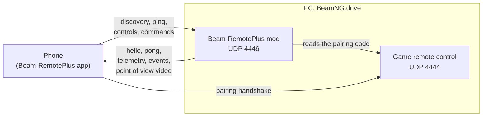

# Beam-RemotePlus — mod

> **The Android app is required.** This mod is the game side of
> Beam-RemotePlus: on its own it does nothing visible. Install the app from
> [Beam-RemotePlus-Mobile](https://github.com/LucienLassalle/Beam-RemotePlus-Mobile/releases/latest).

Drive [BeamNG.drive®](https://www.beamng.com/) with your phone: tilt
steering, analog pedals, live dashboard, vehicle buttons and damage view.

**Beam-RemotePlus** is a **community project**: a
free, open source mod and app made by players. It is **not an official
BeamNG product** and is not affiliated with, endorsed or supported by
BeamNG GmbH. It replaces BeamNG's former phone controller,
[BeamNG/remotecontrol](https://github.com/BeamNG/remotecontrol), which is no
longer maintained.

## Features

- Analog steering, throttle and brake through a virtual game controller.
- Safety: when a phone loses the Wi-Fi for a second, or the player leaves,
  its car no longer accelerates: it brakes until it stops (5 seconds at
  most), then the handbrake holds it.
- Dashboard telemetry: speed, RPM, gear, fuel or battery, temperatures,
  warning lights, indicators, ABS/ESC/TCS, cruise control, g-forces, tyre
  pressures, drive mode.
- Vehicle state: body and engine damage, drivetrain, tyres, brakes, clutch,
  the real structure of the vehicle for the phone's damage view, and a radar
  of the cars around.
- Point of view video (BeamNG.drive 0.40 or newer): the phone can show the
  view from the driver's seat of its own car, rendered by the game in a
  hidden view (the PC screen keeps its own camera). It costs the PC an extra
  render of the world at reduced detail per phone watching it, like one more
  split-screen view, and each captured frame waits for the graphics card:
  measured 60 → 47 fps in game for a 30 fps video (BeamNG.drive 0.40, 1440p).
- Vehicle functions from the phone: horn, lights, indicators, hazards,
  parking brake, ignition, drive mode, gearbox mode, cruise control, gears,
  recovery, vehicle and camera switching, and on police cars, ambulances,
  fire trucks and pace cars the emergency lights and siren.
- Every other command of the vehicle for the phone's **More** sheet: fog
  lights, 4WD, low range, differential lock, launch control, nitrous,
  trailer coupler... and the vehicle's own actions (tailgate, crane,
  vehicle mods), as listed in Options > Controls.
- In-game panel: connected players, lock out new phones, kick a phone.
- Second-screen phones (display only) and local multiplayer (one phone per
  player): a phone joins as the next free player, which the game's local
  multiplayer setup can then move or remove.
- English and French.

## Requirements

- The [Beam-RemotePlus Android app](https://github.com/LucienLassalle/Beam-RemotePlus-Mobile/releases/latest)
  (Android 7.0 or newer).
- The phone and the PC on the same local network (Wi-Fi, or the phone's
  hotspot).

## Installation

1. Download `Beam-RemotePlus.zip` from the
   [latest release](https://github.com/LucienLassalle/Beam-RemotePlus-Mod/releases/latest)
   and put it in the `mods/` folder of your BeamNG.drive user folder (or
   drag it onto the game window).
2. Enable **Beam-RemotePlus** in the mod manager. It then starts with the
   game.
3. Install the Android app, put the phone on the same network, load a level
   and tap **Automatic connection** in the app.

New phones can be locked out at any time with the **Beam-RemotePlus: lock
out new phones** action (Options > Controls > General) or the optional
**Beam-RemotePlus** UI app; phones already connected keep driving.

## In-game panel

The optional **Beam-RemotePlus** UI app (UI apps menu, BeamNG.drive 0.39 or
newer) shows:

- the pairing code, and with the **QR** button its QR code, to scan with
  the app (it also holds the PC address, so the phone finds the PC even
  without broadcast); both stay hidden until clicked;
- **Lock out new phones**: phones already connected keep driving, new ones
  cannot pair (until the game restarts);
- every connected phone with its player number (*Player 1*, *Player 2*…)
  or *Second screen*, the version of its app (when the app
  sends it), and a red cross to **kick** it after confirmation.
  A coloured bar shows the colour the game gives its player (its name tag
  above the car in local multiplayer, also shown on the phone).   Its status is live: **Connected**, **Signal lost** (no news for a
  second: its car brakes for 5 seconds) or **Disconnected** (greyed out,
  listed 30 seconds more).
  A kicked phone goes back to its pairing screen and may connect again
  later, unless new phones are locked out.
- under a phone, a warning when its app and the mod are not the same
  release: **App out of date** (update the app on that phone) or **Newer
  app** (update the mod). Older apps do not send their version and
  never get this warning.
- the **Optional mods** tab, next to the phones: the optional mods below,
  what each one adds, and whether it is **enabled**, **installed but
  disabled** or **not installed**, as the game's mod manager reports it.

## Network

The mod only talks to phones on your local network, never to the internet,
and connects to no server.

Two UDP ports are open on the PC, on all its network interfaces, so a
phone finds the PC whether it uses the Wi-Fi, the Ethernet network or the
phone's own hotspot:

| Port | Opened by | Receives |
|---|---|---|
| UDP **4446** | the mod | discovery, ping, controls, commands |
| UDP **4444** | the game's own remote control (`core_remoteController`), opened by the mod; pairs no new phone while they are locked out | the app's pairing handshake |

The mod answers each phone on the address the request came from. The ports
used on the phone are described in the
[app README](https://github.com/LucienLassalle/Beam-RemotePlus-Mobile#network).



- A phone drives only after sending the 5-digit pairing code shown in the
  game. **Automatic connection** gets that code from the mod, so any device
  on the same local network can connect: use a network you trust.
- New phones are allowed by default and can be locked out at any time (see
  [In-game panel](#in-game-panel)): the mod then ignores them, port 4446
  stays open for the phones already connected. Port 4444 accepts the same
  pairing code, so the mod also stops it from pairing new phones (even if
  the game's own "use a phone or tablet" option was ticked) until unlocked.
- Windows may ask to allow BeamNG.drive through the firewall on first
  launch. If the phone cannot find the PC, allow **incoming UDP 4444 and
  4446**, for example in an administrator PowerShell:

  ```powershell
  New-NetFirewallRule -DisplayName "Beam-RemotePlus" -Direction Inbound -Protocol UDP -LocalPort 4444,4446 -Action Allow
  ```

  With the phone's connection shared over USB (USB tethering), Windows sees
  a new network, usually classified as **Public**: the rule above covers
  every network profile, while an "allow" given only to private networks at
  the Windows prompt does not.

  If **Cancel** was clicked on the Windows prompt, Windows created *block*
  rules for BeamNG.drive, and a block rule always wins over an allow rule.
  List them, then remove them (Windows asks again on the next launch):

  ```powershell
  Get-NetFirewallRule -Direction Inbound -Action Block | Where-Object DisplayName -Match "BeamNG"
  Get-NetFirewallRule -Direction Inbound -Action Block | Where-Object DisplayName -Match "BeamNG" | Remove-NetFirewallRule
  ```

## Optional: tyre temperatures

With a tyre thermals mod enabled, the phone also shows the temperature and
wear of each tyre. Nothing changes for that mod, and nothing is sent
without it. Both versions on the BeamNG.drive repository work:

- **Tyre Wear and Thermals Redux** by Zesty_Maple98, maintained
  continuation of the original (recommended);
- **Luuks Tyre Thermals and Wear Mod** by lucky4luuk, the original, marked
  unsupported since its author stepped back (last update January 2024).

## Optional: vehicle mods

Some vehicle mods add their own controls. When the player drives one of
them, the phone also offers these controls (F4 theme); with any other
vehicle nothing changes, and none of these mods is needed:

| Vehicle mod (BeamNG.drive repository) | Controls on the phone |
|---|---|
| **CF26** (add-on of the F4, its F3 configurations) | DRS, Push-to-Pass, pit limiter |
| **Carbonworks F4** by LucasBE (fr04) | pit limiter |
| **FR17** | DRS (switches it to its manual mode) |

The mod uses the same vehicle values as these mods' own keys and changes
none of their files.

## Development

```bash
scripts/test_mod.sh         # unit tests (luajit)
scripts/build_mod.sh        # dist/Beam-RemotePlus.zip
scripts/fake_phone.py       # talk to the running game like the app does
```

- Architecture and how to add a command or a language: [CONTRIBUTING.md](CONTRIBUTING.md)
- Wire protocol: [docs/PROTOCOL.md](docs/PROTOCOL.md)
- Releasing: publish a GitHub release tagged
  `v<mod version>-<BeamNG.drive version>` (e.g. `v0.0.3-0.39`). CI builds
  the zip with that version (the sources only say `dev`) and attaches it
  with SBOMs (SPDX + CycloneDX) and checksums.

## License

[CC BY-NC-SA 4.0](LICENSE): you may share and adapt this mod for
non-commercial purposes, with attribution, under the same license.
Beam-RemotePlus complies with the BeamNG.drive EULA and grants BeamNG GmbH
the rights its § 11 asks for: see [BEAMNG-EULA.md](BEAMNG-EULA.md).

BeamNG.drive is a registered trademark of BeamNG GmbH. Beam-RemotePlus is
an independent community project, not affiliated with or endorsed by
BeamNG GmbH.
