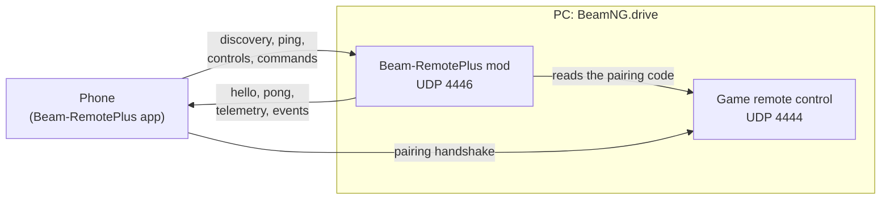

# Beam-RemotePlus — mod

> **The Android app is required.** This mod is the game side of
> Beam-RemotePlus: on its own it does nothing visible. Install the app from
> [Beam-RemotePlus-Mobile](https://github.com/LucienLassalle/Beam-RemotePlus-Mobile/releases/latest).

Drive [BeamNG.drive®](https://www.beamng.com/) with your phone: tilt
steering, analog pedals, live dashboard, vehicle buttons and damage view.

**Beam-RemotePlus** is a **community project**: a
free, open source mod and app made by players. It is **not an official
BeamNG product** and is not affiliated with, endorsed or supported by
BeamNG GmbH. It replaces BeamNG's former phone controller,
[BeamNG/remotecontrol](https://github.com/BeamNG/remotecontrol), which is no
longer maintained.

## Features

- Analog steering, throttle and brake through a virtual game controller.
- Dashboard telemetry: speed, RPM, gear, fuel or battery, temperatures,
  warning lights, indicators, ABS/ESC/TCS, cruise control, g-forces, tyre
  pressures, drive mode.
- Vehicle state: body and engine damage, drivetrain, tyres, brakes, clutch,
  the real structure of the vehicle for the phone's damage view, and a radar
  of the cars around.
- Vehicle functions from the phone: horn, lights, indicators, hazards,
  parking brake, ignition, drive mode, gearbox mode, cruise control, gears,
  recovery, vehicle and camera switching.
- Second-screen phones (display only) and local multiplayer (one phone per
  player).
- English and French.

## Requirements

- The [Beam-RemotePlus Android app](https://github.com/LucienLassalle/Beam-RemotePlus-Mobile/releases/latest)
  (Android 7.0 or newer).
- The phone and the PC on the same local network (Wi-Fi, or the phone's
  hotspot).

## Installation

1. Download `Beam-RemotePlus.zip` from the
   [latest release](https://github.com/LucienLassalle/Beam-RemotePlus-Mod/releases/latest)
   and put it in the `mods/` folder of your BeamNG.drive user folder (or
   drag it onto the game window).
2. Enable **Beam-RemotePlus** in the mod manager. It then starts with the
   game.
3. Install the Android app, put the phone on the same network, load a level
   and tap **Automatic connection** in the app.

Phones can be blocked at any time with the **Enable Beam-RemotePlus
(phones)** action (Options > Controls > General) or the optional
**Beam-RemotePlus** UI app.

## Network

The mod only talks to phones on your local network, never to the internet,
and connects to no server.

Two UDP ports are open on the PC, on all its network interfaces, so a
phone finds the PC whether it uses the Wi-Fi, the Ethernet network or the
phone's own hotspot:

| Port | Opened by | Receives |
|---|---|---|
| UDP **4446** | the mod | discovery, ping, controls, commands |
| UDP **4444** | the game's own remote control (`core_remoteController`), started by the mod to get the pairing code (when a level loads, by default) | the app's pairing handshake |

The mod answers each phone on the address the request came from. The ports
used on the phone are described in the
[app README](https://github.com/LucienLassalle/Beam-RemotePlus-Mobile#network).



- A phone drives only after sending the 5-digit pairing code shown in the
  game. **Automatic connection** gets that code from the mod, so any device
  on the same local network can connect: use a network you trust.
- Phones are allowed by default and can be blocked at any time (see
  [Installation](#installation)); the mod then closes port 4446. Port 4444
  belongs to the game and stays open until it quits.
- Windows may ask to allow BeamNG.drive through the firewall on first
  launch. If the phone cannot find the PC, allow **incoming UDP 4444 and
  4446**, for example in an administrator PowerShell:

  ```powershell
  New-NetFirewallRule -DisplayName "Beam-RemotePlus" -Direction Inbound -Protocol UDP -LocalPort 4444,4446 -Action Allow
  ```

  If **Cancel** was clicked on the Windows prompt, Windows created *block*
  rules for BeamNG.drive, and a block rule always wins over an allow rule.
  List them, then remove them (Windows asks again on the next launch):

  ```powershell
  Get-NetFirewallRule -Direction Inbound -Action Block | Where-Object DisplayName -Match "BeamNG"
  Get-NetFirewallRule -Direction Inbound -Action Block | Where-Object DisplayName -Match "BeamNG" | Remove-NetFirewallRule
  ```

## Optional: tyre temperatures

With the **Tyre Thermals and Wear** mod (by Luuk, on the BeamNG.drive
repository) enabled, the phone also shows the temperature and wear of each
tyre. Nothing changes for that mod, and nothing is sent without it.

## Development

```bash
scripts/test_mod.sh         # unit tests (luajit)
scripts/build_mod.sh        # dist/Beam-RemotePlus.zip
scripts/fake_phone.py       # talk to the running game like the app does
```

- Architecture and how to add a command or a language: [CONTRIBUTING.md](CONTRIBUTING.md)
- Wire protocol: [docs/PROTOCOL.md](docs/PROTOCOL.md)
- Releasing: publish a GitHub release tagged
  `v<mod version>-<BeamNG.drive version>` (e.g. `v0.0.3-0.39`). CI builds
  the zip with that version (the sources only say `dev`) and attaches it
  with SBOMs (SPDX + CycloneDX) and checksums.

## License

[CC BY-NC-SA 4.0](LICENSE): you may share and adapt this mod for
non-commercial purposes, with attribution, under the same license.
Beam-RemotePlus complies with the BeamNG.drive EULA and grants BeamNG GmbH
the rights its § 11 asks for: see [BEAMNG-EULA.md](BEAMNG-EULA.md).

BeamNG.drive is a registered trademark of BeamNG GmbH. Beam-RemotePlus is
an independent community project, not affiliated with or endorsed by
BeamNG GmbH.
